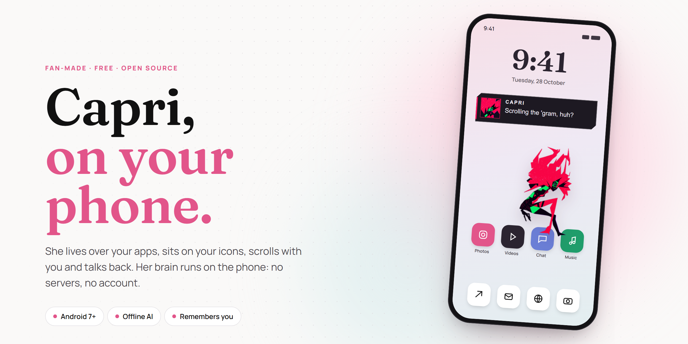
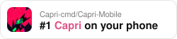
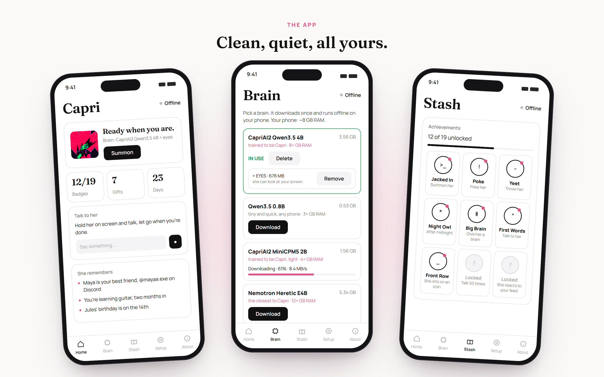
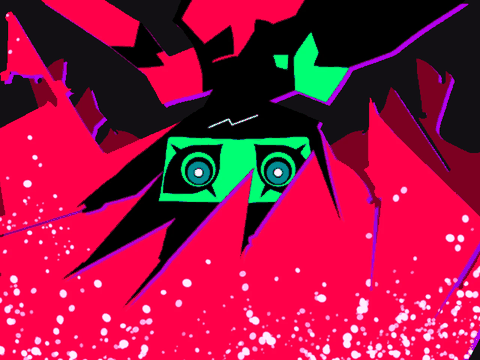
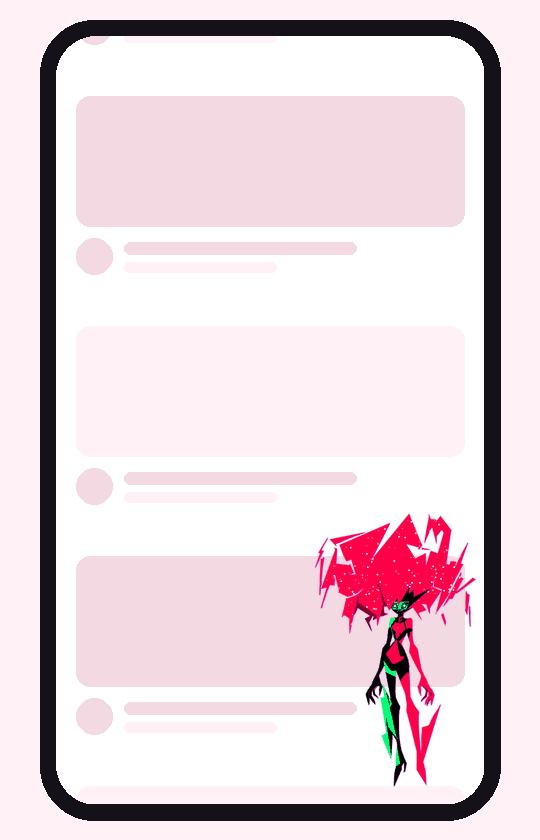
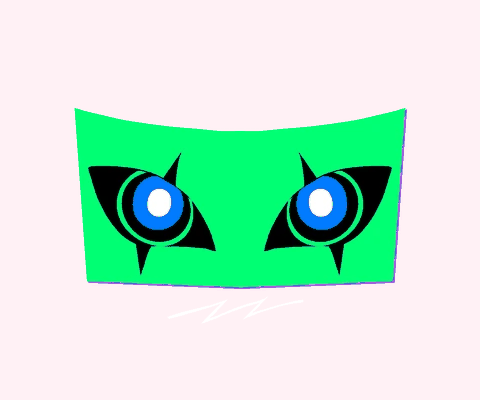
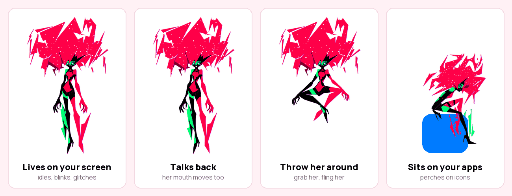
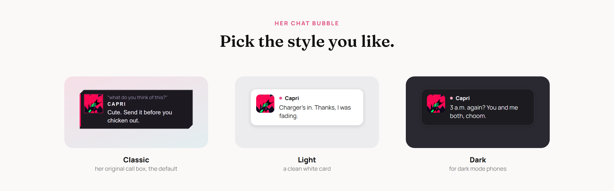

<div align="center">



<br>

<a href="https://github.com/Capri-cmd/Capri-Mobile"></a>

<br><br>

[](https://github.com/Capri-cmd/Capri-Mobile/releases/latest)
&nbsp;


**Capri from *Cyberpunk: Edgerunners 2* lives on your phone.**<br>
She floats over your apps, sits on your icons, reacts to what you're doing and talks back.<br>
Her brain runs on the phone itself, on your PC through LM Studio, or on NVIDIA's cloud with your own free key. No servers of ours, no account, no tracking.

</div>

<br>

## Get her in 1 minute

| 1. Install | 2. Summon | 3. Give her a brain |
|---|---|---|
| Download the APK from **[Releases](https://github.com/Capri-cmd/Capri-Mobile/releases/latest)** and open it. Allow installing unknown apps if your phone asks. | Open Capri, tap **Allow** (draw over other apps), then **Summon**. She's on your screen. | In the **Brain** tab, download one. *CapriAI2* is the lightest; the bigger ones are smarter. It downloads once and works offline. Or connect **LM Studio** on your PC. |

Optional, in **Setup**: allow the mic to talk to her, and turn on Accessibility so she can sit on icons, see your screen and react to it.

<br>

<div align="center"></div>

## See her move

<table>
<tr>
<td align="center" valign="top" width="34%"><br><b>A big entrance</b><br><sub>she fills your screen, then lands</sub></td>
<td align="center" valign="top" width="33%"><br><b>Reacts on her own</b><br><sub>one short line, then back to lurking</sub></td>
<td align="center" valign="top" width="33%"><br><b>Mini form</b><br><sub>just her eyes, anywhere you drag them</sub></td>
</tr>
</table>

## What she does

- **A big entrance.** The same intro as the desktop: it fills your screen, shrinks onto her spot and she bursts out of it.
- **Lives on your screen.** She idles, blinks, glitches and zaps across the screen by breaking into her own pixels.
- **Reacts to you.** Double tap to poke her head or her body. Keep poking and she storms off.
- **Throw her around.** Fling her and she bounces. Throw her into the edge and she hides there, peeking. Shake the phone and she gets dizzy; tilt it and she slides.
- **Sits on your apps.** She perches on icons and buttons, and falls off when they move.
- **Talks back.** Tap her and type in the little box, hold her and talk, or use the **Chat** tab. Her mouth moves while she talks. Her brain is a real AI model on your phone, or on your PC with LM Studio.
- **Sees your screen.** Ask *"look at this"* and she takes a look (with the optional **Eyes** add-on, a vision model in LM Studio, or NVIDIA).
- **Remembers your life.** Names, usernames, birthdays, what people like. She brings it up later, and sometimes trolls you with it. You can read and delete every memory.
- **Reacts on her own.** Every minute or two she glances at the app you're in and drops one short line: your feed, the comments, your chats. She skips banking, wallet and password apps and login screens, and you can switch it off.
- **Goes mini.** Her small form is just her eyes: drag them anywhere, tap to type, hold to talk. She goes mini by herself now and then, or turn on **Always mini** and she stays that way.
- **Speaks your language.** English, Español, Português, Français, Русский, Italiano, Deutsch and Polski. Pick one the first time you open the app (or later in Setup): the app and her replies switch to it. Translations live in `app/src/main/assets/lang`, one file per language, so fixes are welcome.
- **Keeps it short.** One quick line, like a text from a friend.
- **Notices things.** Your charger, low battery, late nights, the app you open.
- **Your look, your theme.** A clean light theme or a dark one, and a secret look to find.
- **Gets out of the way.** Fullscreen videos and games: she shrinks to her eyes in the corner and comes back after. Over the keyboard or a text box she turns see-through and lets your taps through.

<div align="center"></div>

<div align="center"></div>

## Brains

Pick one in the app. All of them are trained to be Capri. Bigger is smarter but needs more RAM.

| Brain | Size | Phone RAM | |
|---|---|---|---|
| **CapriAI2 (Qwen3.5 4B)** | 2.8 GB | 6 GB+ | trained to be Capri, can see |
| **Conversational 7B** | 4.4 GB | 8 GB+ | fast and chatty, gets facts wrong sometimes |
| **Nemotron Heretic E4B** | 5.3 GB | 12 GB+ | the best one, can see |

**Eyes:** every brain except Conversational 7B has an optional vision add-on (0.7 to 1 GB) so she can see your screen (Android 11+).
Have your own model? **Add your own .gguf** in the Brain tab.

**NVIDIA (free, cloud):** in the Brain tab pick *NVIDIA*, tap *Get my free key*, make an account, get an API key and paste it. She then thinks with Nemotron Ultra 550B and sees through NVIDIA's vision model on the same key, with nothing to download. What you say goes to NVIDIA, and your screen too when you ask her to look. She only sends it by herself if you switch on *Let her look on her own*.

**Her ears:** in the Brain tab, download *Qwen3-ASR* (1 GB): the same ears as the desktop, right on your phone. Without it she uses your phone's speech recognizer.

**LM Studio on your PC:** in the Brain tab pick *LM Studio*. On your PC, load any model in LM Studio, start the server in the Developer tab and turn on *Serve on Local Network*. With your phone on the same Wi-Fi, tap *Find on Wi-Fi* (or type your PC's address), then *Use LM Studio*. Load a vision model and she can see your screen with it.

## New versions

On Wi-Fi the app checks GitHub now and then. When there's a new release you get a notification and a card on Home that open the [Releases](https://github.com/Capri-cmd/Capri-Mobile/releases/latest) page. Install it over the old one and everything stays.

## Your stuff is safe

- **Updates keep everything.** Install a new version over the old one and her brains, memories, your name and settings are all still there. Nothing downloads again.
- **Brains stay.** With file access allowed, her brains live in `Capri/models` on your phone, so they stay even if you delete the app, and a new install finds them.
- **Uninstalling asks first.** Android asks if you want to keep her data, so a reinstall picks up where you left off.
- **Backups.** Her memory, your name and settings ride along with your phone's backup. Brains are too big for that, so they download again on a new phone.
- **Nothing goes to us.** No accounts, no analytics, no servers of ours. Internet is only used to download what you pick from Hugging Face, to talk to NVIDIA if you chose it, and, on Wi-Fi, to ask GitHub if there's a new version. With LM Studio, your chats and what she looks at go only to your own PC.

<details>
<summary><b>Help: something isn't working</b></summary>

<br>

- **Accessibility switch is greyed out (Android 13+).** Go to *App info → ⋮ → Allow restricted settings*, then turn it on again.
- **She disappears after a while.** Some phones (Xiaomi, Samsung, Huawei...) kill background apps. Set Capri's battery usage to *Unrestricted*.
- **Her replies are slow.** Use a smaller brain. CapriAI2 is the lightest, or run her on LM Studio or NVIDIA.
- **What Accessibility is used for.** Finding icons to sit on, seeing which app is open and, with *React on her own* on, glancing at your screen for a reaction (never banking, wallet or password apps, or login screens). Nothing is saved, and it only goes to the brain you picked: with NVIDIA, your screen goes there by itself only if you switch on *Let her look on her own*.

</details>

<details>
<summary><b>Build it yourself</b></summary>

<br>

Android Studio (2026.x), **NDK 28.2.13676358**, **CMake 3.22.1**.

```bash
git clone https://github.com/Capri-cmd/Capri-Mobile.git
```

llama.cpp lives in `third_party/llama.cpp` (tag **b11932**, MIT). It's compiled into `libcapri_llama.so` by `app/src/main/cpp/CMakeLists.txt`, with a small JNI bridge in `capri_llama.cpp`. Open the project, let Gradle sync, and run. The APK also carries an x86_64 build for the emulator.

```
app/src/main/java/com/capri/mobile/
  CapriService.kt   her: movement, touch, senses, talking
  CapriAccess.kt    accessibility: icons to sit on, the app in front, the words on screen
  Brain.kt          her character sheet, memory, llama.cpp calls
  LmStudio.kt       LM Studio on your PC and NVIDIA as her brain
  Intro.kt          her entrance  ·  TypeBox.kt  the little box to type in  ·  Updates.kt  the new version alert
  ModelStore.kt     the brain catalog   ·   DownloadService.kt  resumable downloads
  Ears.kt           the phone's speech recognizer  ·  QwenEars.kt  Qwen3-ASR on the phone
  MainActivity.kt   the app (Home / Setup)  ·  ChatScreen.kt  ·  BrainScreen.kt
```

</details>

## Credits

- **Art** by **xilia_world00** (Discord): Capri, her mini form, the Watcher, her poses, the intro and the app icon.
- **CapriAI2 models** trained by **[ghasty3](https://github.com/ghasty3)** ([Hugging Face](https://huggingface.co/Ghasty3/CapriAI2)). She's the reason Capri sounds like Capri.
- **llama.cpp** by [ggml-org](https://github.com/ggml-org/llama.cpp), MIT.
- **Her ears:** [Qwen3-ASR](https://huggingface.co/ggml-org/Qwen3-ASR-0.6B-GGUF) by the Qwen team, Apache 2.0.
- **Conversational 7B** by [xiaoheiqaq](https://huggingface.co/xiaoheiqaq).
- **Base models** keep their own licenses (Qwen: Apache 2.0, NVIDIA Nemotron). See each model's page.
- **Fonts:** Manrope, Share Tech Mono and Fraunces, [SIL Open Font License](NOTICE.md).
- **Thanks** to [Lachy](https://github.com/lachydotmcg), whose sprite art the first versions of this app used.

## Support us

Capri is free and always will be. If you want to help, everything is on our [linktree](https://linktr.ee/capriai).

## Legal

**Capri Mobile is an unofficial, non-commercial fan project.** It is not made, endorsed or sponsored by CD PROJEKT RED, Studio Trigger or R. Talsorian Games, and it's not for sale. Capri, Cyberpunk: Edgerunners and Cyberpunk 2077 are trademarks and characters of CD PROJEKT S.A.; *Cyberpunk* is a trademark of R. Talsorian Games. All rights stay with their owners. **No official art, audio, logos or video** ship with this app.

The app's code is under the [PolyForm Noncommercial License 1.0.0](LICENSE): free to use, change and share, never for sale. Third-party pieces: [NOTICE.md](NOTICE.md).

If you're a rights holder and want something changed or taken down, [open an issue](https://github.com/Capri-cmd/Capri-Mobile/issues) and it will be handled right away.

<div align="center"><br><sub>made by the Capri crew · choom approved</sub></div>
