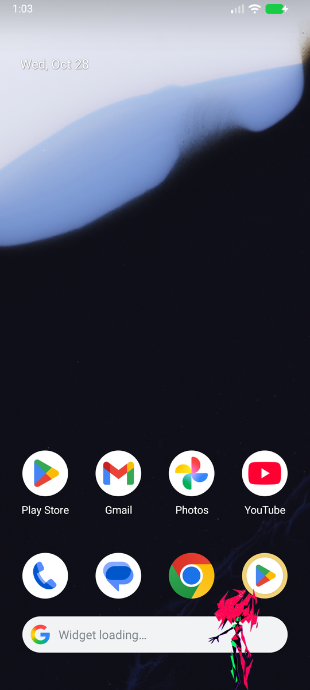
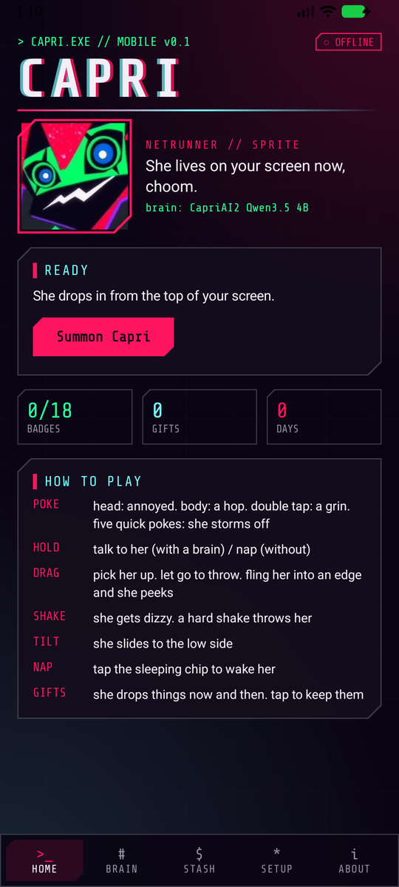
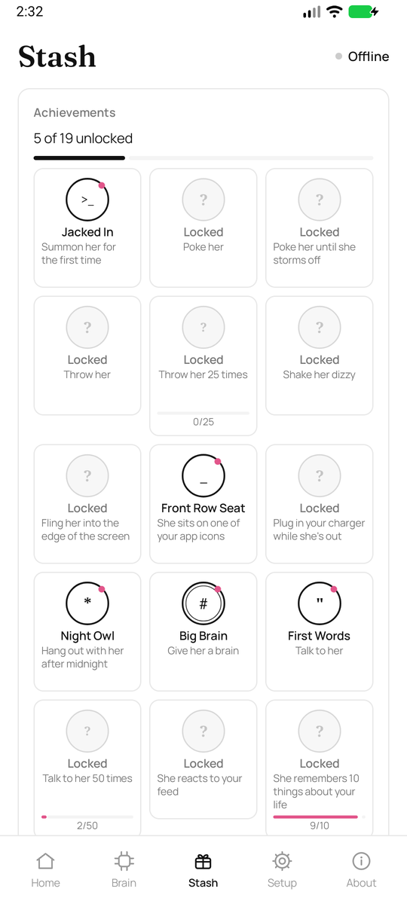

<div align="center">

# CAPRI // MOBILE

**Capri from *Cyberpunk: Edgerunners 2*, living on your phone.**
She floats over your apps, sits on your icons, scrolls TikTok with you, and talks back with a brain that runs *on your phone*. No servers, no account.


**[⬇ Download the APK](https://github.com/Capri-cmd/Capri-Mobile/releases/latest)** &nbsp;·&nbsp; the first Capri on a phone, ever

  

</div>

---

## What she does

| | |
|---|---|
| **Lives on your screen** | Floats over every app. Idles, blinks, glitches, zaps across the screen by breaking into her own pixels. |
| **Poke her** | Head: annoyed. Body: a hop. Double tap: a grin. Five quick pokes and she storms off. |
| **Throw her** | Grab, fling, watch her bounce. Throw her into the edge of the screen and she hides there, peeking. |
| **Shake & tilt** | Shake your phone and she gets dizzy. Tilt it and she slides. Both can be switched off. |
| **Sits on your apps** | Perches on app icons and buttons, falls off when they move. Throw her onto one. |
| **Sees your screen** | Ask "look at this" / "what am I watching?" and she takes a look. Give her brain its **Eyes** (a small extra download) and she actually sees the screen; without them she reads its words. |
| **Remembers your life** | Talk to her or show her something (a Discord DM, a profile) and she writes down what matters: who people are, their usernames, what they like, plans, birthdays. She brings it up later, and sometimes trolls you with it. Every memory is listed in the app: read it, delete it, or switch memory off. It never leaves your phone. |
| **Talks back** | Hold her and talk. Her brain is an LLM running on your phone with llama.cpp. Pick one in the app, it downloads once and works offline. |
| **Scroll with me** | In TikTok, Reels, Shorts, Reddit and X she reads the caption and comments and, every now and then, drops a reaction. Like a friend doomscrolling next to you. |
| **Notices things** | Your charger, low battery, late nights, the app you open, unlocking your phone in the morning. |
| **Hides when it matters** | Fullscreen videos and games: she steps away and comes back after. |
| **Gifts & achievements** | She drops gifts now and then (from Eddies to a Relic fragment). 19 badges to unlock. Not into it? Switch the Game off in Setup. |
| **Naps** | Hold her (no brain) or say "go to sleep": she curls up in a corner. Tap to wake her. |

## Install

1. Grab `Capri.apk` from **[Releases](https://github.com/Capri-cmd/Capri-Mobile/releases/latest)** and open it on your phone (allow installing unknown apps).
2. Open Capri, **Allow** drawing over other apps, then **Summon Capri**.
3. **BRAIN** tab: download a brain. Start with *Qwen3.5 0.8B* to try it, then a CapriAI2 one.
4. **SETUP** tab: allow the mic (talking) and switch on Accessibility (sitting on icons, app reactions, Scroll with me).
   On Android 13+ the accessibility switch is greyed out for downloaded apps: **App info → ⋮ → Allow restricted settings**, then try again.

Works on Android 7.0+, 64-bit phones (arm64). Some phones (Xiaomi, Samsung, Huawei...) kill background apps: set Capri's battery usage to *Unrestricted* so she stays.

## Brains

Downloaded inside the app, smallest first. All run on the phone's CPU.

| Brain | Size | Phone RAM | Notes |
|---|---|---|---|
| Qwen3.5 0.8B | 0.53 GB | 3 GB+ | tiny and quick |
| Qwen3.5 2B | 1.28 GB | 4 GB+ | smarter, still light |
| **CapriAI2 MiniCPM5 2B** | 1.56 GB | 4 GB+ | trained to be Capri |
| **CapriAI2 Qwen3.5 4B** | 3.56 GB | 8 GB+ | trained to be Capri |
| **CapriAI2 Gemma 4 E4B** | 5.34 GB | 12 GB+ | trained to be Capri |
| **Nemotron Heretic E4B** | 5.34 GB | 12 GB+ | closest to Capri |

**Eyes**: every brain except MiniCPM5 has an optional vision add-on (0.2–1 GB) that lets her look at your screen (Android 11+).

Got your own? **Add your own .gguf** in the BRAIN tab: anything this llama.cpp version runs works.
The CapriAI2 models were trained by **[ghasty3](https://github.com/ghasty3)** ([Hugging Face](https://huggingface.co/Ghasty3/CapriAI2)): she's the reason Capri sounds like Capri.

## Privacy

Everything happens on your phone. No accounts, no analytics, no servers of ours. Her memories live in the app's private storage and you can read, delete or wipe them any time. The only network traffic is downloading the brains you pick (from Hugging Face).
Accessibility is optional and only used to find icons to sit on, see which app is open and, with *Scroll with me* on, read a feed's text for a reaction. Nothing is saved or sent. Speech goes through your phone's own speech recognizer.

## Build from source

Android Studio (2026.x), **NDK 28.2.13676358**, **CMake 3.22.1**.

```bash
git clone https://github.com/Capri-cmd/Capri-Mobile.git
```

llama.cpp lives in `third_party/llama.cpp`: the parts the app needs from tag **b11932** (the same build as the desktop Capri), MIT licensed. It's compiled into `libcapri_llama.so` by `app/src/main/cpp/CMakeLists.txt`, with a small JNI bridge in `capri_llama.cpp`. Open the project, let Gradle sync, and run. The APK also carries an x86_64 build, so it runs on the emulator.

```
app/src/main/java/com/arubih/capriai/
  CapriService.kt   her: movement, touch, senses, talking, gifts, achievements
  CapriAccess.kt    accessibility: icons to sit on, the app in front, feed text
  Brain.kt          her character sheet, memory, llama.cpp calls
  ModelStore.kt     the brain catalog   ·   DownloadService.kt  resumable downloads
  Ears.kt           hold-to-talk speech recognition
  MainActivity.kt   the app (Home / Brain / Stash / Setup / About)
```

## Credits & legal

**Capri is an unofficial, non-commercial fan project.** It is not made, endorsed or sponsored by CD PROJEKT RED, Studio Trigger or R. Talsorian Games, and it's not for sale.

- **Capri, Cyberpunk: Edgerunners, Cyberpunk 2077** are trademarks and characters of CD PROJEKT S.A. *Cyberpunk* is a trademark of R. Talsorian Games. All rights to them stay with their owners.
- **Sprite art** by [Lachy](https://github.com/lachydotmcg), [PolyForm Noncommercial 1.0.0](app/src/main/assets/LICENSE.md). The app icon and her nap are cut from it: **no official art, audio, logos or video** ship with this app.
- **Model training**: the CapriAI2 models (MiniCPM5 2B, Qwen3.5 4B, Gemma 4 E4B, Nemotron E4B) by [ghasty3](https://github.com/ghasty3).
- **llama.cpp** by [ggml-org](https://github.com/ggml-org/llama.cpp), MIT.
- **Models** each keep their own license (Qwen: Apache 2.0, MiniCPM, Gemma, NVIDIA Nemotron): see their Hugging Face pages.
- **Share Tech Mono** font by Carrois Apostrophe, [SIL Open Font License](app/src/main/assets/OFL-ShareTechMono.txt).

**License:** the app's code is under the [PolyForm Noncommercial License 1.0.0](LICENSE): free to use, change and share, never for sale. Third-party pieces and their licenses: [NOTICE.md](NOTICE.md).

If you're a rights holder and want something changed or taken down, [open an issue](https://github.com/Capri-cmd/Capri-Mobile/issues) and it will be handled right away.

<div align="center">

*made by the Capri crew // choom approved*

</div>
