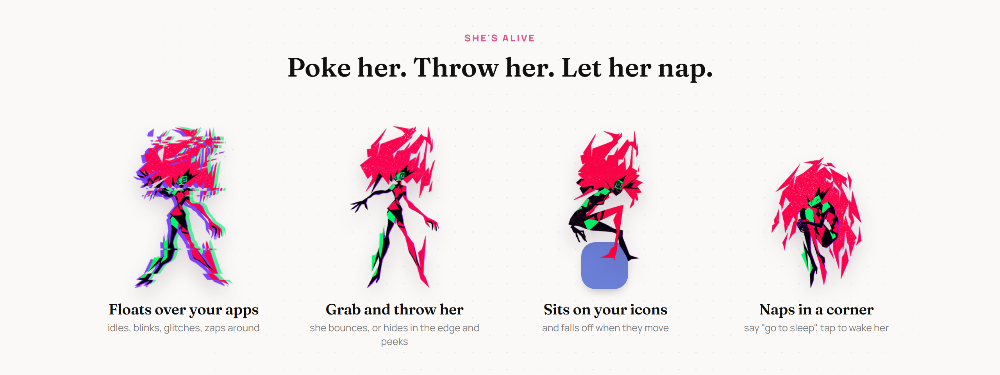

<div align="center">


<br>

<a href="https://github.com/Capri-cmd/Capri-Mobile"></a>

<br><br>

[](https://github.com/Capri-cmd/Capri-Mobile/releases/latest)
&nbsp;


**Capri from *Cyberpunk: Edgerunners 2* lives on your phone.**<br>
She floats over your apps, sits on your icons, scrolls with you and talks back.<br>
Her brain runs on the phone itself: no servers, no account, no tracking.

</div>

<br>

## Get her in 1 minute

| 1. Install | 2. Summon | 3. Give her a brain |
|---|---|---|
| Download the APK from **[Releases](https://github.com/Capri-cmd/Capri-Mobile/releases/latest)** and open it. Allow installing unknown apps if your phone asks. | Open Capri, tap **Allow** (draw over other apps), then **Summon**. She's on your screen. | In the **Brain** tab, download one. Start with *Qwen3.5 0.8B*, try a *CapriAI2* one later. It downloads once and works offline. |

Optional, in **Setup**: allow the mic to talk to her, and turn on Accessibility so she can sit on icons and react to what you're scrolling.

<br>

<div align="center"></div>

## What she does

- **Lives on your screen.** She idles, blinks, glitches and zaps across the screen by breaking into her own pixels.
- **Reacts to you.** Poke her head, her body, double tap her. Five quick pokes and she storms off.
- **Throw her around.** Fling her and she bounces. Throw her into the edge and she hides there, peeking. Shake the phone and she gets dizzy; tilt it and she slides.
- **Sits on your apps.** She perches on icons and buttons, and falls off when they move.
- **Talks back.** Hold her and talk. Her brain is a real AI model running on your phone.
- **Sees your screen.** Ask *"look at this"* and she takes a look (with the optional **Eyes** add-on).
- **Remembers your life.** Names, usernames, birthdays, what people like. She brings it up later, and sometimes trolls you with it. You can read and delete every memory.
- **Scrolls with you.** In TikTok, Reels, Shorts, Reddit and X she reads the caption and sometimes drops a reaction.
- **Notices things.** Your charger, low battery, late nights, the app you open.
- **Gets out of the way.** Fullscreen videos and games: she steps away and comes back after.
- **Gifts and achievements.** She drops gifts now and then, and there are 19 badges to find. Not your thing? Switch **Game** off.

<div align="center"></div>

<div align="center"></div>

## Brains

Pick one in the app. Bigger is smarter but needs more RAM.

| Brain | Size | Phone RAM | |
|---|---|---|---|
| Qwen3.5 0.8B | 0.5 GB | 3 GB+ | tiny and quick |
| Qwen3.5 2B | 1.3 GB | 4 GB+ | smarter, still light |
| **CapriAI2 MiniCPM5 2B** | 1.6 GB | 4 GB+ | trained to be Capri |
| **CapriAI2 Qwen3.5 4B** | 3.6 GB | 8 GB+ | trained to be Capri |
| **CapriAI2 Gemma 4 E4B** | 5.3 GB | 12 GB+ | trained to be Capri |
| **Nemotron Heretic E4B** | 5.3 GB | 12 GB+ | the closest to Capri |

**Eyes:** every brain except MiniCPM5 has an optional vision add-on (0.2 to 1 GB) so she can see your screen (Android 11+).
Have your own model? **Add your own .gguf** in the Brain tab.

## Your stuff is safe

- **Updates keep everything.** Install a new version over the old one and her brains, memories, your name, badges and settings are all still there. Nothing downloads again.
- **Uninstalling asks first.** Android asks if you want to keep her data, so a reinstall picks up where you left off.
- **Backups.** Her memory, your name and settings ride along with your phone's backup. Brains are too big for that, so they download again on a new phone.
- **Nothing leaves your phone.** No accounts, no analytics, no servers of ours. The only internet traffic is downloading the brains you pick from Hugging Face.

<details>
<summary><b>Help: something isn't working</b></summary>

<br>

- **Accessibility switch is greyed out (Android 13+).** Go to *App info → ⋮ → Allow restricted settings*, then turn it on again.
- **She disappears after a while.** Some phones (Xiaomi, Samsung, Huawei...) kill background apps. Set Capri's battery usage to *Unrestricted*.
- **Her replies are slow.** Use a smaller brain. The 0.8B one runs on almost anything.
- **What Accessibility is used for.** Finding icons to sit on, seeing which app is open and, with *Scroll with me* on, reading a feed's text for a reaction. Nothing is saved or sent.

</details>

<details>
<summary><b>Build it yourself</b></summary>

<br>

Android Studio (2026.x), **NDK 28.2.13676358**, **CMake 3.22.1**.

```bash
git clone https://github.com/Capri-cmd/Capri-Mobile.git
```

llama.cpp lives in `third_party/llama.cpp` (tag **b11932**, MIT). It's compiled into `libcapri_llama.so` by `app/src/main/cpp/CMakeLists.txt`, with a small JNI bridge in `capri_llama.cpp`. Open the project, let Gradle sync, and run. The APK also carries an x86_64 build for the emulator.

```
app/src/main/java/com/capri/mobile/
  CapriService.kt   her: movement, touch, senses, talking, gifts, achievements
  CapriAccess.kt    accessibility: icons to sit on, the app in front, feed text
  Brain.kt          her character sheet, memory, llama.cpp calls
  ModelStore.kt     the brain catalog   ·   DownloadService.kt  resumable downloads
  Ears.kt           hold-to-talk speech recognition
  MainActivity.kt   the app (Home / Brain / Stash / Setup / About)
```

</details>

## Credits

- **Sprite art** by [Lachy](https://github.com/lachydotmcg), [PolyForm Noncommercial 1.0.0](app/src/main/assets/LICENSE.md). The app icon and her nap are cut from it.
- **CapriAI2 models** trained by **[ghasty3](https://github.com/ghasty3)** ([Hugging Face](https://huggingface.co/Ghasty3/CapriAI2)). She's the reason Capri sounds like Capri.
- **llama.cpp** by [ggml-org](https://github.com/ggml-org/llama.cpp), MIT.
- **Models** keep their own licenses (Qwen: Apache 2.0, MiniCPM, Gemma, NVIDIA Nemotron).
- **Fonts:** Manrope, Fraunces and Share Tech Mono, [SIL Open Font License](NOTICE.md).

## Legal

**Capri Mobile is an unofficial, non-commercial fan project.** It is not made, endorsed or sponsored by CD PROJEKT RED, Studio Trigger or R. Talsorian Games, and it's not for sale. Capri, Cyberpunk: Edgerunners and Cyberpunk 2077 are trademarks and characters of CD PROJEKT S.A.; *Cyberpunk* is a trademark of R. Talsorian Games. All rights stay with their owners. **No official art, audio, logos or video** ship with this app.

The app's code is under the [PolyForm Noncommercial License 1.0.0](LICENSE): free to use, change and share, never for sale. Third-party pieces: [NOTICE.md](NOTICE.md).

If you're a rights holder and want something changed or taken down, [open an issue](https://github.com/Capri-cmd/Capri-Mobile/issues) and it will be handled right away.

<div align="center"><br><sub>made by the Capri crew · choom approved</sub></div>
